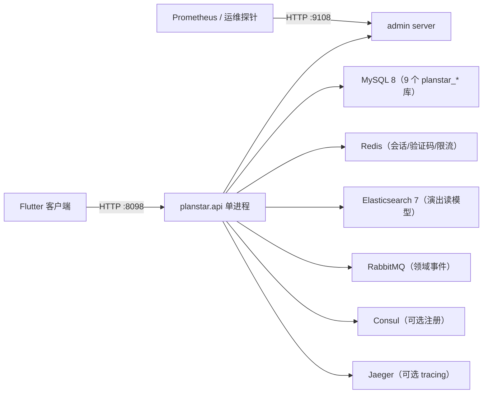
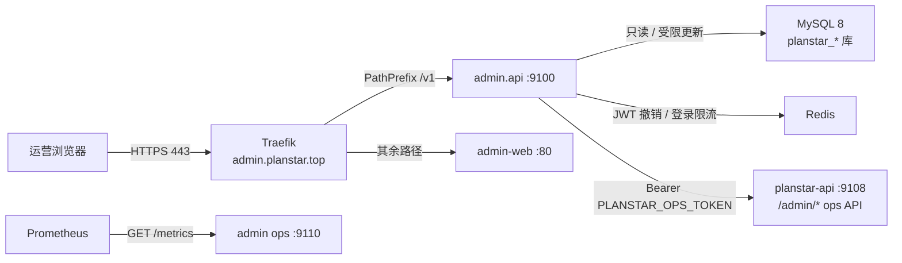

> 适用版本：planstar 单体 · 最后核对：2026-11-07 · 维护：后端组

# 当前架构（planstar 单体）

本文件描述**当前实际运行**的 `planstar/` 服务，不包含 kratos-shop 微服务模板。历史微服务描述见 [legacy/architecture-microservices.md](legacy/architecture-microservices.md)。运营后台 `admin` 作为同实例部署的独立进程/容器，见第 11 节。

## 1. 进程与端口



| 监听 | 地址 | 作用 |
| --- | --- | --- |
| 业务 HTTP | `0.0.0.0:8098` | 24 条客户端路由（23 个唯一端点，`GET /v1/user/` 是 `GET /v1/user` 的尾斜杠别名） |
| 运维 HTTP | `0.0.0.0:9108` | `/metrics`、`/healthz`、`/readyz`，与业务端口分离，避免指标暴露在公网 API |

两个 HTTP server 都由 Kratos v3 transport 承载，随 `kratos.App` 启停；MQ 消费者作为第三个 `transport.Server` 接入同一生命周期。入口与依赖装配在 `planstar/cmd/planstar/main.go`，**没有 Wire 代码生成**。

## 2. internal 分层

| 目录 | 职责 | 依赖约束 |
| --- | --- | --- |
| `internal/server/` | 业务 HTTP server、运维 admin server、CORS、panic 兜底 | 只依赖 `conf`、`observability` |
| `internal/service/` | Transport 适配：解析 HTTP DTO、校验边界、调用 biz 用例、写响应；`Register` 注册全部路由 | 只依赖 `biz`、`pkg`、`observability`；不导入 `data` 或存储驱动 |
| `internal/biz/` | 用例、领域对象（DO）、仓储端口、领域事件、类型化错误 | 纯 Go；不导入 `net/http`、`database/sql`、Redis、AMQP、Elasticsearch |
| `internal/data/` | 实现 biz 仓储端口：MySQL、Redis、Elasticsearch；`*Data` 持有长连接 | 依赖 `biz` 端口与 `conf` |
| `internal/pkg/` | `captcha`、`secret`、`session`、`httpx` 等无状态工具 | 可被 service/biz 复用 |
| `internal/mq/` | RabbitMQ 发布器、消费者、DLX、trace 透传 | 实现 `biz.EventPublisher`，不反向依赖 service |
| `internal/observability/` | Prometheus 指标、Jaeger tracing、日志 trace 字段、路由标签归一化 | 被 server/service 使用 |
| `internal/conf/` | 配置结构、默认值、`PLANSTAR_*` 环境变量覆盖 | 只依赖 YAML 与 os |

```text
client → DTO → service → DO → biz → DO → data → PO → storage
                              ▲             ▲
                              │ 声明端口     │ 实现端口
                              └─────────────┘
```

依赖方向单向：`cmd → service → biz ← data`。`biz` 不感知传输与存储；`data` 只能通过 biz 定义的接口被注入。`cmd` 是唯一装配点。

## 3. 请求生命周期

1. Kratos HTTP transport 接收请求：连接级 `ReadTimeout=10s`、`WriteTimeout=30s`、`IdleTimeout=60s`；单请求 context 超时 `15s`（均可由 `server.http.*` 覆盖）。CORS 按 `cors_allow_origins` 白名单放行，白名单为空时仅允许同源，携带 Cookie 凭据。
2. 中间件由外到内：`observability.Metrics.Middleware`（提取 W3C `traceparent`、创建 server span、记录请求量/延迟/在途数、把数字 ID / 长十六进制段归一化为 `:id`）→ `traceHeader`（生成/透传 `X-Trace-Id`）→ `bodyLimit`（默认 1 MiB，`/v1/upload` 放宽到 20 MiB，超限 413 JSON）→ `timeoutHandler`（15s，超时 504 JSON，并丢弃超时后的业务写入）→ `recoverer`。
3. `recoverer` 兜住 handler panic：记录 `path`、`panic` 日志，返回统一 JSON `500 INTERNAL`。
4. `http.ServeMux` 按 Go 1.22 的 `METHOD /path` 模式路由到 `service` 层 handler。
5. `service` 解析 query/body/path 参数，需要登录的端点通过 `Cookie: psSession` 解析用户：Redis 会话缓存优先，未命中回源 `planstar_user.login_session`，命中后回填 Redis。
6. `biz` 用例做参数与业务校验，调用仓储端口；`data` 访问对应逻辑库、Redis 或 Elasticsearch。
7. `service` 用 `httpx.JSON` 输出裸 JSON（无 `{code,message,data}` 信封）；图片、文本等端点单独写 Content-Type。
8. 指标、span 与访问日志在响应后收尾：`planstar_http_requests_total`、`planstar_http_request_duration_seconds` 与 `http request` 日志共用同一 `route` 标签；日志通过 `observability.NewTraceHandler` 自动附加 `trace_id`/`span_id`。
9. 进程收到 `SIGTERM`/`SIGINT` 后，`kratos.App` 先执行 `BeforeStop`，注销 Consul 实例，再并发停止三个 `transport.Server`（业务 HTTP、admin HTTP、MQ 消费者），最多等待 `StopTimeout=15s`；全部停止后再执行 `AfterStop`、关闭 MySQL/MQ/tracing。

失败响应由 `service.fail` + `httpx.Error` 统一为 `{"code","message","traceId"}`，并通过响应头 `X-Trace-Id` 回传同一个 traceId。订单业务码 `PRICE_CHANGED`/`SOLD_OUT`/`LIMIT_EXCEEDED`/`QUOTE_EXPIRED` 已映射为 409。报价快照（Redis 优先、进程内 TTL 降级）与「单事务扣库存 + 幂等键」已落地；SKU 级定价仍以票档最低在售价聚合，细化场次/票档策略为后续工作。`httpx.Plain` 仅保留给历史调用方，当前业务错误不再使用。

## 4. MySQL 多逻辑库

`internal/data/data.go` 固定 9 个逻辑库，按域建连接池（`SetMaxOpenConns(20)`、`SetMaxIdleConns(5)`、`ConnMaxLifetime(30m)`），启动时逐个 `Ping`，任一失败即启动失败。

| 逻辑库 | 当前主要用途 |
| --- | --- |
| `planstar_user` | `user_info`、`user_statistic`、`user_address`、`user_message`、`login_session`、`login_code` |
| `planstar_catalog` | `activity`、`activity_event`、`activity_category`、`city`、`venue`、`activity_lineup`、`activity_detail` |
| `planstar_ticket` | `ticket_category`、`ticket_group`（票档与可售数量） |
| `planstar_order` | `order_info`（订单列表、详情、创建） |
| `planstar_payment` | 支付相关表（当前无 HTTP 端点直接读写） |
| `planstar_marketing` | 营销相关表（当前无 HTTP 端点直接读写） |
| `planstar_community` | `feed`、`feed_media`、`review` |
| `planstar_content` | `banner` |
| `planstar_meta` | 字典等元数据（当前无 HTTP 端点直接读写） |

建库与表结构以 [sql/README.md](sql/README.md) 和 `docs/sql/00_all.sql` 为基线；库间 **0 物理外键**，一致性由应用层保证。

金额规则：数据库 `order_info.pay_amount` / `total_amount` 为 `DECIMAL(12,2)` **元**；HTTP 契约统一用 **分**，biz 层 `Fen` 做 `round(元 × 100)`，下单写入时 `fenToYuan` 做 `/100`。

## 5. Redis 会话与风控缓存

Redis 不是数据源，只保存短期状态；未配置 `data.redis.addr` 时 `data.AuthCache` 退化为进程内 map（仅单实例可用）。

| Key 前缀 | 内容 | TTL |
| --- | --- | --- |
| `planstar:session:<token>` | `psSession` → userID | `auth.session_expire_days`（默认 30 天） |
| `planstar:captcha:<id>` | 图形验证码明文，一次性消费 | 5 分钟 |
| `planstar:send:<mobile>` | 发码冷却标记（`AuthCache` 能力，当前主流程不依赖） | 60 秒 |
| `planstar:login:fail:<mobile>` | 登录失败计数（`AuthCache` 能力，当前主流程不依赖） | 10 分钟 |

会话同时落库 `planstar_user.login_session`（`access_token`、`expire_time`），Redis 只做加速；缓存不可用时回源 MySQL。图形码校验在缓存异常时**失败关闭**。

发码冷却与 IP 限频、登录失败计数由 `service/auth.go` 的进程内 `authLimiter` 执行：同一手机号默认 60 秒冷却、同一 IP 默认每分钟 10 次、连续失败默认 3 次触发图形码（均由 `auth.*` 配置覆盖）。该实现是**单机语义**，多实例部署时各实例独立计数；`data.AuthCache` 仍保留 Redis 版发码/失败计数键，便于后续切换。

## 6. Elasticsearch 读模型

- 别名：`<index_prefix>-activities`（默认 `planstar-activities`），物理索引 `<别名>-<UTC 时间戳>`；单分片、0 副本。
- 文档字段见 `internal/data/es_catalog.go` 的 `esActivityMapping`：`activity_id`、`name`、`city_name`、`category_id`、`category_name`、`venue_name`、`low_price`、`want_watch_num`、`rank_weight`、`star`、`status`、`publish_status`、`poster`、`first_time`。
- 启动流程：`EnsureIndex` 先迁移旧版“同名具体索引”→ 若发现遗留的 `planstar-activities` 具体索引则删除；随后 `RunSync` 立即执行一次全量重建，并按 `sync_interval_seconds`（默认 300s，可由 `PLANSTAR_ES_SYNC_INTERVAL_SECONDS` 覆盖）周期执行。
- 全量重建 `SyncActivities`：新建时间戳索引 → 分页/批量写入上架活动（`status=1 AND publish_status=1`）→ `Refresh` → 原子切换别名 → 删除旧索引；任一步失败保留旧索引并清理新索引，期间查询继续走旧别名。单次同步超时 60s。
- `UpsertActivity` / `DeleteActivity` 提供单文档增量能力，并已接入 MQ：消费 `catalog.activity.changed` 时 upsert、`catalog.activity.deleted` 时删除；周期全量重建仍保留作为兜底。
- 热门榜 `GET /v1/activities/hot` 在无 `categoryId`/`city` 过滤时先由 ES 按 `want_watch_num`、`rank_weight`、`activity_id` 取 ID，再回 MySQL 补全详情并保持 ES 顺序。
- ES 查询失败、超时或返回空 ID 时，代码路径回落 MySQL 排序，并累加 `planstar_catalog_es_fallback_total`；日志同时记录 `Warn`。

## 7. RabbitMQ 领域事件

| 项 | 值 |
| --- | --- |
| Exchange | `planstar.exchange`（topic，持久化） |
| Queue | `planstar.api.events`（持久化） |
| Routing key | `user.registered`、`order.created`、`catalog.activity.changed`、`catalog.activity.deleted` |
| 死信 | `planstar.exchange.dlx` → `planstar.api.events.dlq`（`failed.planstar.api.events`） |
| 重试 | 最多 5 次，第 n 次延迟 n 秒后重投；超过后进 DLQ 并 ACK |
| trace | 发布时注入 W3C trace 头，消费时提取并创建 consumer span |

发布器 `mq.Publisher` 懒连接、断线重连、发布超时 5s；未配置 `mq.addr` 时 `main` 注入 `biz.NopEventPublisher`，主流程不受影响。消费者 `mq.Server` 连接失败每 5s 重试；`mq.addr` 为空时只打印 `rabbitmq disabled`。消费到 `user.registered` / `order.created` 后写入站内消息 `planstar_user.user_message`；消费到 `catalog.activity.*` 后维护 ES 读模型。

## 8. 降级与故障边界

| 依赖 | 启动时不可用 | 运行中不可用 |
| --- | --- | --- |
| MySQL | `NewData` 逐个 `Ping` 失败，进程启动失败 | 请求返回 5xx，`/readyz` 503；连接池自动重连 |
| Redis（已配置） | `Ping` 失败，启动失败 | 会话回源 MySQL；图形码校验失败关闭；发码/登录失败计数为进程内语义，不受 Redis 影响 |
| Redis（未配置） | 使用进程内缓存，可启动 | 仅单实例有效，重启丢失短期状态 |
| Elasticsearch（已配置） | `ClusterHealth` 失败，启动失败 | 热门榜回退 MySQL；同步任务告警；`/readyz` 503 |
| Elasticsearch（未配置） | 热门榜直接走 MySQL | 同左 |
| RabbitMQ（已配置） | 消费者 5s 重试，不阻塞启动 | 发布失败仅记日志，主流程继续；消费者自动重连 |
| RabbitMQ（未配置） | publisher 为 Nop，消费者禁用 | 同左 |
| Consul（已配置） | 注册失败会导致 `app.Run` 失败；仅能通过留空 `registry.consul.address` 完全跳过 | 不影响已运行进程的业务请求 |
| Jaeger（endpoint 为空） | tracing 为 no-op | 同左 |

## 9. 可观测性

- 指标：`planstar_http_requests_total{method,route,status}`、`planstar_http_request_duration_seconds{method,route}`、`planstar_http_requests_in_flight{method}`、`planstar_biz_login_total{result}`、`planstar_biz_order_confirm_total{result}`、`planstar_biz_order_created_total{result}`、`planstar_catalog_es_fallback_total`，以及 Go/Process collector；`/metrics` 使用独立 Registry。
- 链路：Jaeger exporter（`trace.endpoint`），采样率 `trace.sample_ratio`，服务名 `planstar.api`。
- 日志：`slog` 文本输出到 stdout，包含 `service.id`、`service.name`、`service.version`；span 有效时附加 `trace_id`、`span_id`。
- 访问日志：每个请求结束记录一条 `http request`，字段为 `method`、`route`（与指标同源归一化）、`status`、`duration_ms`、`remote_addr`；`route` 不使用原始路径，避免高基数。
- HTTP 响应头 `X-Trace-Id` 回传请求 traceId；错误响应体的 `traceId` 与响应头保持一致。成功响应体不额外包 `traceId` 字段。

## 10. Kratos v3 规范对齐

本节记录与 [Kratos v3 官方文档](https://go-kratos.dev/zh-cn/docs/getting-started/start/)的对应关系，避免后续维护者误判「用了 Kratos 就必须有 proto/Wire」。

| 官方约定 | 本项目落地 | 状态 |
| --- | --- | --- |
| 依赖内聚：`service → biz → data`，`cmd` 为组装根 | 分层一致；`main` 手工装配，无 Wire | 已对齐 |
| `kratos.New` 管理生命周期、`Server` 注册传输层 | 业务 HTTP、admin HTTP、MQ 消费者均实现 `transport.Server` | 已对齐 |
| `StopTimeout` / `RegistrarTimeout` / `BeforeStart`·`AfterStart`·`BeforeStop`·`AfterStop` | `StopTimeout=15s`、`RegistrarTimeout=5s`，四个钩子输出结构化生命周期日志 | 已对齐 |
| 配置启动期失败关闭 | `conf.Validate` 在加载后校验地址、端口、URL 与超时顺序；失败直接非零退出 | 已对齐（YAML + 环境变量，非 proto config） |
| 服务注册与注销 | `consul` registrar，注册发生在服务器启动后，停止前注销 | 已对齐 |
| 日志与 trace 关联 | `klog` + `NewTraceHandler`，日志自动携带 `trace_id`/`span_id` | 已对齐 |
| `khttp.Server` + 中间件组合 | 使用 `khttp.Server`；因 handler 是裸 `http.Handler`，未使用 `khttp.Middleware`，改为 `server` 内显式组合链（trace → body limit → timeout → recover → access log/metrics） | 有意偏差 |
| `api/*.proto` + 生成的 HTTP binding + OpenAPI | 无 proto；REST 契约以 `docs/api/API_CONTRACT.md` 为准，并由 `routes_test.go` 做路由比对 | 有意偏差 |
| `kratos/errors`（code + reason + metadata） | 对外固定 `{code,message,traceId}`；`biz` 哨兵错误在 `service.fail` 映射为状态码与业务码 | 有意偏差 |
| Wire 依赖注入 | 手工装配，依赖数量可控；引入 Wire 收益不足 | 有意偏差 |

**偏差原因**：现有 23 个端点与 Flutter 客户端已按裸 JSON + Cookie 会话契约稳定运行，直接切换到 protobuf HTTP binding 会改变请求/响应形状，属于破坏性变更。若后续需要 OpenAPI 与强类型客户端，可先「只生成 OpenAPI/客户端、不改 handler」，再评估迁移。

详细指标与处置见 [operations.md](operations.md)。

## 11. 运营后台（planstar/admin）

`admin/` 是独立的 `planstar/admin` Go 模块（Kratos v3），与 `planstar/` 业务单体同实例部署、同 MySQL 数据源，但进程、端口、鉴权与 Cookie 完全隔离。控制台（Ant Design Pro / Umi Max）构建为静态资源，由独立 `admin-web`（nginx）容器托管。



| 监听 | 地址 | 暴露方式 | 作用 |
| --- | --- | --- | --- |
| 管理 HTTP | 容器内 `0.0.0.0:9100` | 仅容器网络，经 Traefik `/v1/*` | `/v1/admins/*`、`/v1/planstar/*` |
| 管理 gRPC | 容器内 `0.0.0.0:9101` | 不发布 | 内部 gRPC（当前控制台走 HTTP） |
| 运维 HTTP | 容器内 `0.0.0.0:9110` | 宿主机 `127.0.0.1:9110` | `/metrics`、`/healthz`、`/readyz` |
| 控制台静态站 | 容器内 `admin-web:80` | 仅容器网络，经 Traefik | SPA 静态资源与 fallback |

**数据边界**：管理库 `planstar_admin`（`admins`、`admin_audit_log`）可读写；`planstar_user/catalog/order/payment/marketing/community/content/meta` 仅允许 `SELECT`，其中仅 `planstar_user.user_info` 额外允许受限 `UPDATE`（用户状态）。管理端禁止跨库 JOIN，查询字段使用白名单；企划审核与举报处置不复制黑名单规则，统一调用 `planstar-api` 的 `9108` ops API（`POST /admin/projects/{id}/review`、`POST /admin/reports/{id}/handle`），ops 不可用时返回 `503` 而不是静默放行。

**鉴权与 Cookie 隔离**：

- 管理员登录 `POST /v1/admins/login` 下发 `psAdminToken`（JWT，`HttpOnly`、生产 `Secure`、`SameSite=Strict`）；业务客户端仍使用 `psSession`，两者名称、Path 与域名不同，互不读取、互不覆盖。
- 角色矩阵 `viewer < operator < admin`：`viewer` 只读控制台数据；`operator` 可改用户状态、审核企划、处置举报；`admin` 额外可管理管理员账号。服务端逐方法校验，越权返回 `403`。
- 登录失败按「账号 + 来源 IP」在 Redis 计数并锁定，超限返回 `429`；非 GET 请求校验 `Origin` 白名单，失败返回 `403` 且不执行写操作。
- 配置密钥仅通过 `ADMIN_*` 环境变量注入；生产环境空 JWT 密钥、`auto_migrate=true` 会在启动校验阶段失败。

**可观测**：`admin` 独立 Prometheus job（`job="admin"`、`service="admin.api"`），指标为 `requests_total{method,path,code}` 与 `duration_seconds{method,path}`（见 `admin/internal/server/metrics.go`）；日志/链路的 `service.name` 规划为 `admin.api`（镜像需注入 `main.Name`，见 [admin-integration.md](admin-integration.md)），审计写入 `admin_audit_log` 并输出 `admin audit` 结构化日志。部署、告警与回滚见 [admin-integration.md](admin-integration.md)。
